# v1 User Flows (UX-1)

The steps each person takes in v1, one flow per job. Part of [design.md](design.md) (stage 1). The text below is the source: the FigJam board is drawn from it, so change the text first, then redraw.

- **How to read the diagrams:** rounded ends = start or finish · diamond = a decision · slanted box = something typed in (leaning right) or sent out, like an email (leaning left) · double-sided box = the system doing work · dotted arrow = happens later. Light blue = CA on the desktop, light teal = owner on the phone, grey = ComplyPilot itself. Orange = something to fix, red = blocked, green = done.
- **Decisions these flows follow (2026-10-19):** email-link login for everyone; the owner answers the factory questions and the CA can fill them in or correct them; the owner sees "Your CA will check" until the CA confirms; the owner ticks off only tasks the CA gives them.

## Which flow covers which feature
| Feature | Flows |
|---|---|
| F1 Firm sign-up, consent, colleagues | F-01, F-02 |
| F2 Add clients, CSV import, choose filings | F-03 |
| F3 Invite the owner, email-link login | F-04, F-01 |
| F4 Factory questions and licence rules | F-05 |
| F5 Due dates and override dates | F-03 (dates worked out), F-11 |
| F6 Shared calendar | F-06 |
| F7 Licence tracker | F-07 |
| F8 CA's own repeating tasks | F-08 |
| F9 Item thread and Mark done | F-09 |
| F10 Email reminders | F-10 |
| F11 AI factory type matcher | F-05 |
| F12 Demo story | F-12 and the story below |

## F-01 Sign in (both sides)
Anyone types their email and gets a link. A new email starts a firm sign-up; the sign-up screen tells owners to ask their CA for an invite instead.
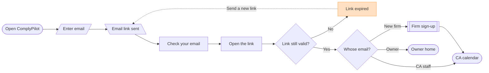

## F-02 Firm sign-up and team (F1)
Consent is stored with who accepted, when, and which notice version (acceptance criterion 1).
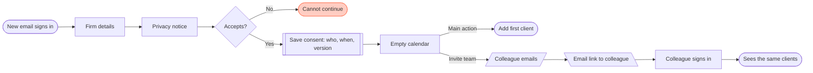

## F-03 Add clients (F2, F5)
By hand or by CSV. A CSV saves its good rows at once and reports the rest by row number and reason, e.g. a bad GSTIN or a PAN the firm already has ([import-formats.md](../research/import-formats.md)). Saved clients get their due dates worked out.
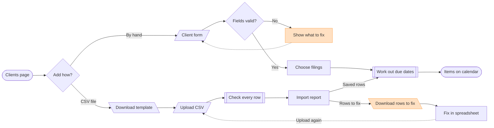

## F-04 Invite the owner (F3)
The CA can resend a pending invite. The owner sees only their own client's items.
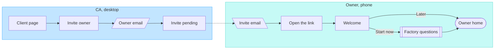

## F-05 Factory questions and CA review (F4, F11)
About 10 questions ([applicability-delhi-haryana.md](../research/applicability-delhi-haryana.md)): state, workers, power, area type, what you make (in plain words, read by the AI matcher), boiler, waste, floor area. Each licence comes back as **Required, Not required, Inform the board, or Ask your CA**, with its source. Unsure cases give "Ask your CA": outside Delhi and Haryana (OT-1), workers in the grey band (FL-2), a Delhi factory outside a conforming industrial area (FL-3), a Red industry in Delhi (PC-3), a sector not on the list (PC-4). Nothing reaches a calendar until the CA confirms.
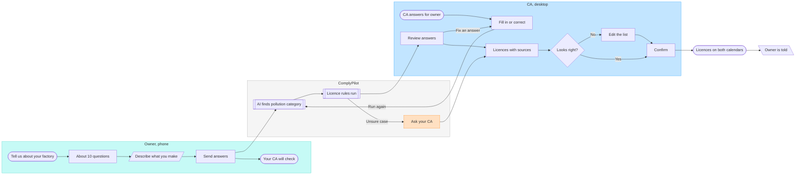

## F-06 Calendar (F6)
The CA sees every client; the owner sees only their own items. A day shows its most urgent status (Carbon's rule, see the [study](../research/design-references.md)).
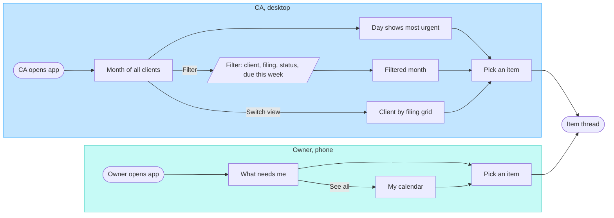

## F-07 Licence tracker (F7)
Warnings at 90, 60 and 30 days, then "Expired". No expiry date shows "Valid until cancelled" ([licences.md](../research/licences.md)). Earlier reminder days for some licences are agreed in UX-4.
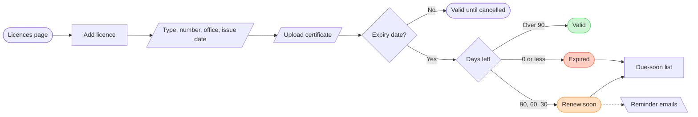

## F-08 CA's own repeating tasks (F8)
A task on the 31st moves to the month's last day in shorter months (acceptance criterion 10).
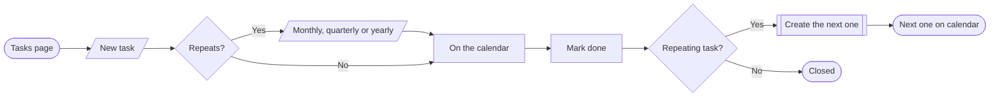

## F-09 Item thread and Mark done (F9)
One thread per calendar item, with fixed tags (Need document, Question, Filed). The owner ticks only the task the CA gave them; the CA marks the filing done with the ARN and receipt (PDF, JPG or PNG, up to 10 MB). Who and when are saved (acceptance criterion 11).
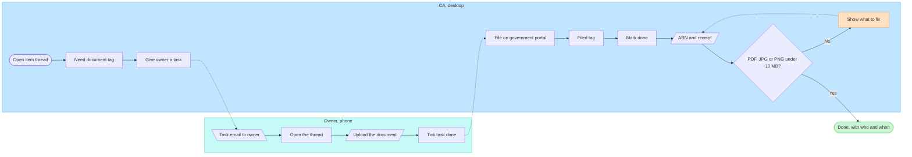

## F-10 Email reminders (F10)
Reminder days agreed 2026-10-21 ([design.md](design.md), UX-4): the firm gets one list each morning (late items and the next 7 days); the owner gets one list each Monday (the next 10 days and anything waiting on them) and an email when the CA gives them a task. Licences count from their apply-by date. Items already marked done never appear (acceptance criterion 12).
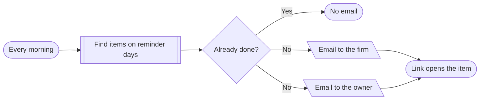

## F-11 Override dates (F5)
When the government extends a date (e.g. CBDT Circular 07/2026 moved the AY 2026-27 audit dates, [due-dates.md](../research/due-dates.md)), the CA changes it once and every affected client updates (acceptance criterion 7).
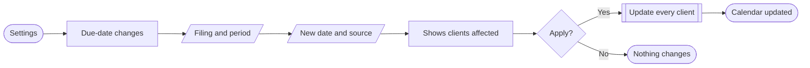

## F-12 Demo path (F12)
The path the clickable prototype follows (UX-4). Blue = CA, teal = owner, green = the one moment of delight.
```mermaid
flowchart LR
    b1["1 Calendar of 100 clients"]
    b2["2 Due this week"]
    b3["3 Licence warning beside GST"]
    b4["4 Add client, invite owner"]
    b5["5 Owner answers questions"]
    b6["6 Your CA will check"]
    b7["7 CA confirms licences"]
    b8["8 Need document"]
    b9["9 Owner uploads"]
    b10["10 Mark done with ARN"]
    b11["11 Reminder email"]

    b1 --> b2 --> b3 --> b4 --> b5 --> b6 --> b7 --> b8 --> b9 --> b10 --> b11
    classDef ca fill:#C2E5FF,stroke:#3DADFF
    classDef owner fill:#C6FAF6,stroke:#5AD8CC
    classDef delight fill:#CDF4D3,stroke:#66D575
    class b1,b2,b3,b4,b7,b8 ca
    class b5,b6,b9,b11 owner
    class b10 delight
```

## Demo story (draft, about 5 minutes)
Made-up data only. The two factories come from the research test set, so the licence results are already known ([test factories](../research/applicability-delhi-haryana.md#test-factories-made-up-these-are-the-f4-tests)).
| # | Time | Who | What the audience sees |
|---|---|---|---|
| 1 | 0:00 | CA | Monday morning at a small Delhi CA firm: the month calendar for 100 factory clients. A few days show amber and red. |
| 2 | 0:30 | CA | Filter "Due this week": the GSTR-3B returns line up. |
| 3 | 0:50 | CA | Sunrise Plastics (Haryana) shows "Hazardous waste authorisation: renew soon" right next to its GST items. **Licences and tax on one calendar: the edge.** |
| 4 | 1:10 | CA | Add a new client, Metro Beverages (Delhi), choose its filings, invite the owner. |
| 5 | 1:50 | Owner | On the phone: the email link, a welcome, then the factory questions. In plain words: "We make soft drinks and fruit juice, and we have a steam boiler." |
| 6 | 2:40 | Owner | "Your CA will check." Nothing is promised until the CA confirms. |
| 7 | 2:50 | CA | The review: the AI match ("Aerated water and fruit beverage with boiler", Orange) with the line it matched. Factory licence, registration, CTE/CTO, fire certificate and boiler certificate are Required, each with its source. Confirm. The licences appear on both calendars. |
| 8 | 3:40 | CA | In the thread for Metro Beverages' GSTR-3B: "Need document: purchase bills", given to the owner as a task. |
| 9 | 4:00 | Owner | The owner uploads the bills from the phone and ticks the task. |
| 10 | 4:20 | CA | The CA files, then **Mark done** with the ARN and receipt: the one moment of delight. |
| 11 | 4:40 | Owner | Close on the owner's reminder email for the next due date: one calendar both sides trust. |

## Edge cases the flows cover
| Case | Flow | Source |
|---|---|---|
| Sign-in link expired | F-01 | design choice |
| An owner who wasn't invited types their email | F-01, F-02 | design choice: sign-up tells owners to ask their CA |
| Privacy notice not accepted | F-02 | [privacy.md](../research/privacy.md) |
| CSV rows with errors, or a GSTIN/PAN the firm already has | F-03 | [import-formats.md](../research/import-formats.md) |
| Factory outside Delhi or Haryana | F-05 | OT-1 |
| Workers in the grey band | F-05 | FL-2 |
| Delhi factory outside a conforming industrial area | F-05 | FL-3 |
| Red industry in Delhi | F-05 | PC-3 |
| Sector not on the list | F-05 | PC-4 |
| White exempt sector (inform the board) | F-05 | PC-1 |
| Licence with no expiry date | F-07 | PC-5, [licences.md](../research/licences.md) |
| Receipt of the wrong type or over 10 MB | F-09 | README criterion 11 |
| Repeating task on the 31st in a shorter month | F-08 | README criterion 10 |
| No reminder for items already done | F-10 | README criterion 12 |
| Government extends a due date | F-11 | [due-dates.md](../research/due-dates.md) |
